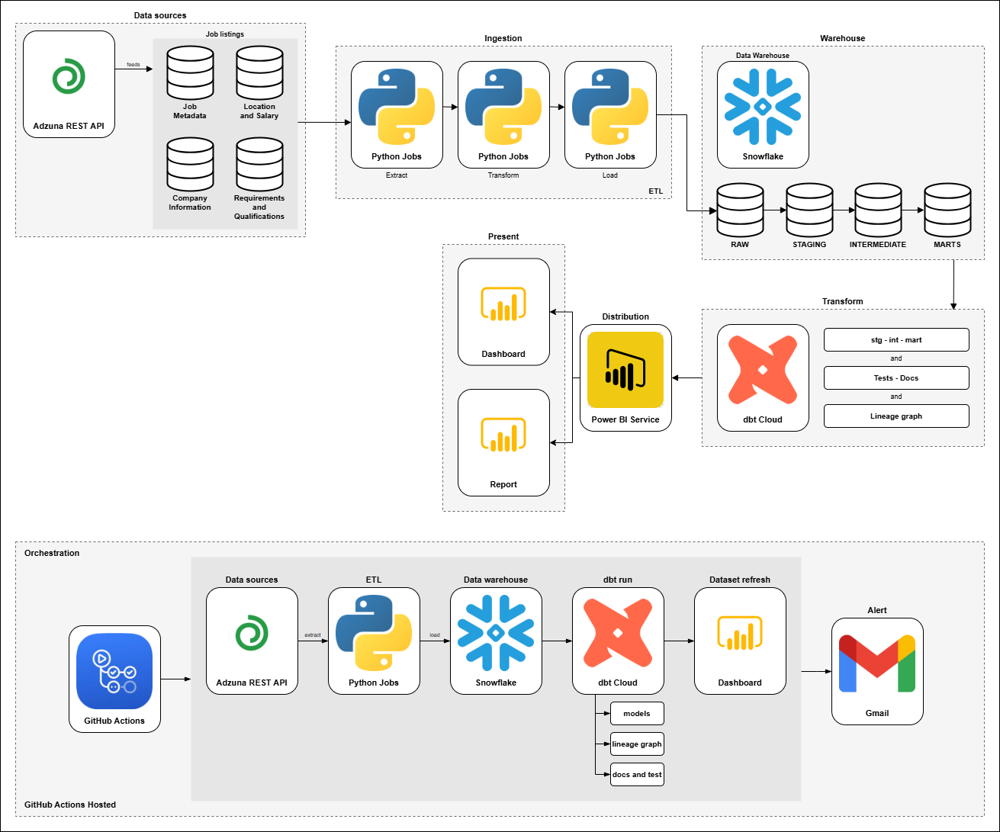

# JobRadar

> An end-to-end data engineering pipeline for analysing the Australian job market.

---

## Overview

JobRadar collects daily job listings from the **Adzuna AU API**, processes and stores them in **Snowflake**, transforms them with **dbt Cloud**, and visualises insights in **Power BI** - all orchestrated automatically via **GitHub Actions**.

### Key Analysis
- Salary trends by role and industry
- In-demand skills (NLP on job descriptions)
- Job volume by location across Australia
- Hiring trends over time

---

## Tech Stack

| Layer | Tool |
|---|---|
| Data Source | Adzuna REST API |
| Ingestion | Python (requests, pandas, spaCy) |
| Orchestration | GitHub Actions |
| Warehouse | Snowflake |
| Transformation | dbt Cloud |
| Visualisation | Power BI |

---

## Architecture

---

## Project Status

> *This project is currently under development.*

---

## Getting Started

> *(Setup instructions will be added once the project is complete)*

---
